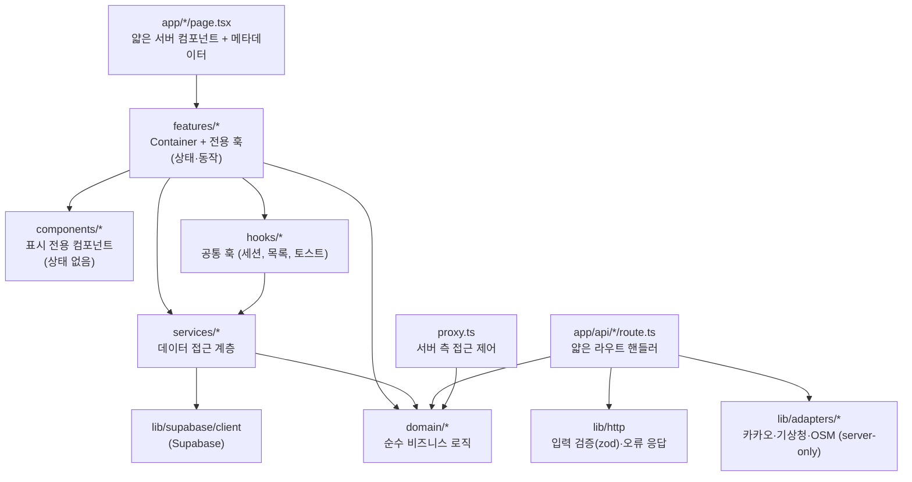
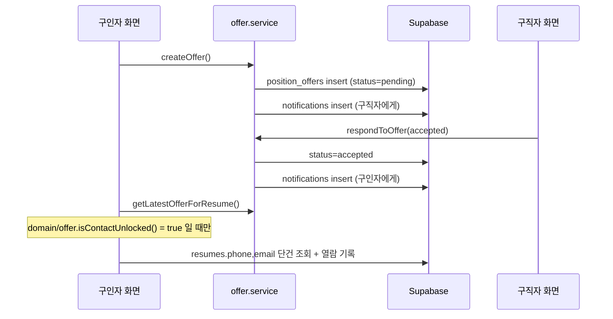

# 🏗️ 현장공수잡 GongsuJob

건설 현장 일용직 **구인·구직 매칭 웹 서비스**입니다.
구인자는 공고를 등록하고 인재에게 **포지션을 제안**하며, 구직자는 제안을 **수락한 경우에만 연락처가 공개**됩니다.

- 라이브 데모: https://gongsujob-phgb.vercel.app
- 제작: 김서인 (PICTORY-droid) · AI 코딩 도구(Claude)를 활용해 설계·구현

[](https://github.com/PICTORY-droid/gongsujob/actions/workflows/ci.yml)

---

## 왜 만들었나

건설 현장의 일용직 인력 연결은 여전히 전화·문자·카카오톡에 의존합니다.
공고와 인재 정보를 한곳에서 확인하되, **연락처를 바로 노출하지 않고 "제안 → 수락" 이후에만 공개**하는 구조로 구직자의 개인정보를 보호하도록 설계했습니다.

## 주요 기능

| 구분 | 기능 |
| --- | --- |
| 공통 | 이메일·Google·Kakao 로그인, 첫 설정(온보딩), 구인자/구직자 화면 분기, 비로그인 메인 미리보기 |
| 구인자 | 공고 등록·삭제, 인재 검색(직종·키워드), 포지션 제안, 구직자 질문에 답변, 수락 후 연락처 확인 |
| 구직자 | 이력서·증명사진 등록, 공고 검색·지원, 제안 수락/거절/질문, 지원 현황 |
| 공고 상세 | 카카오 지오코딩 기반 현장 지도, 기상청 단기예보 기반 **작업 가능 여부**, 일용직 **실수령액 계산기** |
| 공고 탐색 | **찜한 공고**(기기 저장), **급구·지역 필터 칩**, **출근일 배지**(오늘·내일·D-n), 인재 **안전교육 이수** 배지 |
| 홈 | 역할별 **배너 슬라이드**, **직종별 메뉴**(12종 → 목록 필터 연동), 빠른 검색, 기능 안내 |
| 현장관리 (구인자) | 수락된 **확정 인력**을 현장별로 확인, 근무일수 입력 → **노임대장 엑셀**(공제·실지급 자동 계산), **근로계약서** 인쇄·PDF |

---

## 아키텍처

### 계층 구조



| 계층 | 위치 | 책임 | 규칙 |
| --- | --- | --- | --- |
| 라우트 | `app/**/page.tsx` | URL ↔ 화면 연결, 메타데이터(SEO) | 로직 없음. Container 하나만 렌더 |
| 컨테이너 | `features/*/…Container.tsx` | 화면 조립 | 상태는 전용 훅에서 받는다 |
| 화면 훅 | `features/*/use*.ts`, `hooks/` | 상태·사용자 동작·로딩/오류 | Supabase를 직접 부르지 않고 services만 사용 |
| 표시 컴포넌트 | `components/`, `features/*/…Sections.tsx` | 그리기 | props만 받음, 데이터 접근 금지 |
| 서비스 | `services/*.service.ts` | 테이블별 조회·저장, 여러 테이블에 걸친 유스케이스(제안 → 알림) | 화면 상태를 모름. `Result<T>`로 실패 메시지 반환 |
| 도메인 | `domain/*.ts` | 순수 규칙(제안 상태 전이, 실수령액, 기상청 격자, 검증, 리다이렉트 안전 검사) | React·네트워크 의존 0 → 단위 테스트 대상 |
| 어댑터 | `lib/adapters/*` | 외부 API 호출 | `server-only`, `fetch` 주입으로 테스트 가능 |
| 타입 | `types/` | 도메인·UI 타입 단일 정의 | `any` 사용 0 |

### 폴더 구조

```text
app/                      라우트 (얇은 서버 컴포넌트)
├─ api/{geocode,staticmap,weather}/route.ts
├─ auth/callback/route.ts
└─ {jobs,jobs/[id],jobs/write,login,mypage,onboarding,resume/write,resumes,contact}/page.tsx
features/                 화면 단위 컨테이너 + 전용 훅
├─ home/  jobs/  job-detail/  job-write/
├─ resumes/  resume-write/  mypage/  onboarding/  auth/
components/               재사용 표시 컴포넌트
├─ ui/       Modal, Toast, Notice, ChipSelect, CategoryDropdown, Avatar, Form, theme
├─ layout/   AppHeader, HomeHeader, AppFooter, MobileBottomNav
├─ job/      JobCard, JobSummaryCard, NetPayCalculator
├─ resume/   ResumeCard
└─ auth/     AuthForm
hooks/                    useSession, useListings, useToast, useDismissible
services/                 auth, profile, job, resume, application, offer, notification, location
domain/                   profile, offer, offer-form, net-pay, weather, geo, validation, format, search, redirect, job, resume
lib/
├─ adapters/  kakao-local, kma-forecast, osm-tile
├─ supabase/  client(브라우저) · server(라우트 핸들러) · proxy(프록시)
├─ http/      api(검증·오류 응답) · schemas(zod)
├─ config/    env (환경변수 검증)
└─ constants.ts
types/                    domain.ts, ui.ts
tests/                    unit · integration · component
proxy.ts                  Next.js 16 Proxy (구 middleware)
```

### 대표 흐름: 포지션 제안 → 수락 → 연락처 공개



---

## 메뉴 구조 (역할별)

모든 메뉴는 `lib/navigation.ts` 한 곳에서 정의하고, 모바일 하단 탭과 PC 상단 메뉴가 같은 목록을 씁니다.

| 역할 | 메뉴 |
| --- | --- |
| 비로그인 | 홈 · 일자리 · 인재찾기 · 문의 · 로그인 |
| 구직자 | 홈 · 일자리 · 찜 · 내 이력서 · 내정보 |
| 구인자 | 홈 · 인재찾기 · 공고등록 · 현장관리 · 내정보 |

## 사용한 오픈소스

| 용도 | 라이브러리 | 라이선스 |
| --- | --- | --- |
| 배너 슬라이드 | Embla Carousel (+ Autoplay) | MIT |
| 아이콘 | Lucide | ISC |
| 노임대장 엑셀 | write-excel-file (필요할 때만 불러옴) | MIT |
| 서체 | Pretendard → GongsuSans(수정본) | SIL OFL 1.1 |

## 디자인 시스템 (2027)

| 역할 | 색 | 근거 |
| --- | --- | --- |
| 주조색 (헤더·강조·선택) | Luminous Blue `#203C7F` / `#2B59C3` | WGSN·Coloro 2027 올해의 컬러 — 신뢰·안정 |
| 행동색 (버튼·일당) | Energy Orange `#D9480F` | S/S 27 키 컬러 — 건설 안전색 계열, 흰 글자 대비 확보 |
| 바탕 | 따뜻한 오프화이트 `#F7F5F2` | 장시간 보기 편한 저채도 중립색 |
| 상태 | 초록 `#15803D` / 빨강 `#DC2626` | 안전교육 이수 · 급구 |

- 모든 색은 `app/globals.css`의 CSS 변수(`--gs-*`) 한 곳에서 관리하고, 컴포넌트는 `components/ui/theme.ts`로 변수 이름만 참조합니다.
- 글자색은 모두 WCAG AA(4.5:1) 이상, 터치 영역 최소 36~52px, 키보드 포커스 링, 동작 줄이기 설정 존중.
- 서체: Pretendard(SIL OFL)를 완성형 한글 2,350자로 줄인 수정본 `GongsuSans`(약 450KB, `app/fonts/LICENSE.txt`).
- 반응형: 폰 1열 → 태블릿 2열 → PC 3열 카드 그리드, PC 공고 상세는 2단(지도·날씨 고정), `clamp()` 유동 글자 크기, 컨테이너 쿼리.

---

## 테스트 하네스

```bash
npm test               # 전체 테스트
npm run test:coverage  # 커버리지 포함
npm run check          # lint + typecheck + test
```

| 단계 | 위치 | 대상 | 방식 |
| --- | --- | --- | --- |
| Unit | `tests/unit/domain` | 제안 상태 규칙, 실수령액, 기상청 격자·발표시각, 검증, 오픈 리다이렉트 방지 | 순수 함수 (시간은 `now` 주입) |
| Unit | `tests/unit/adapters` | 카카오·기상청·OSM 어댑터 | `fetch` 주입 |
| Unit | `tests/unit/services` | 테이블·조건·알림 발송 여부, 연락처 컬럼 미요청 | Supabase 쿼리 빌더 테스트 더블 |
| Integration | `tests/integration` | API 라우트 핸들러 입력 검증·오류 코드, Proxy 접근 제어 | 실제 핸들러 + 네트워크만 가짜 |
| Component | `tests/component` | 계산기·카드·공통 UI, 훅(응답 경합, 연락처 공개 규칙) | Testing Library + jsdom |

CI(GitHub Actions)는 모든 PR에서 **lint → typecheck → test(coverage) → build** 순으로 검증합니다. 빌드는 실제 키 없이도 통과하도록 클라이언트가 환경변수를 런타임에만 읽습니다.

---

## 보안 설계

- **연락처 최소 수집**: 인재 목록·제안 목록 응답에는 `phone`·`email`·`birth` 컬럼을 아예 요청하지 않습니다. 제안이 `accepted`일 때만 해당 이력서의 연락처를 단건 조회합니다.
- **서버 측 접근 제어**: `proxy.ts`가 로그인·온보딩 완료 여부를 서버에서 검사합니다(클라이언트 검사는 보조).
- **오픈 리다이렉트 차단**: 로그인 후 `redirectedFrom`은 같은 사이트 상대 경로만 허용합니다(`domain/redirect.ts`).
- **외부 API 키 은닉**: 카카오·기상청 키는 서버 라우트에서만 사용하며, 어댑터는 `server-only`로 클라이언트 번들 포함을 막습니다.
- **입력 검증**: API 쿼리는 zod 스키마로 검증하고, 오류 응답에는 내부 메시지·스택을 노출하지 않습니다.
- **소유자 조건**: 공고 삭제 시 `user_id` 조건을 함께 걸어 RLS와 이중으로 방어합니다.
- **업로드 검증**: 증명사진은 이미지 형식·5MB 이하만 허용합니다.

> 데이터베이스 수준 권한(RLS) 권장 정책은 [`docs/SECURITY.md`](docs/SECURITY.md)에 정리했습니다.

---

## 기술 스택

| 구분 | 기술 |
| --- | --- |
| 프레임워크 | Next.js 16.4 (App Router, Proxy), React 19.3, TypeScript (strict) |
| 인증·DB·스토리지 | Supabase Auth · PostgreSQL · Storage (`@supabase/ssr`) |
| 외부 API | 카카오 로컬(지오코딩), 기상청 단기예보, OpenStreetMap 타일 |
| 검증 | zod 4 |
| 보안 헤더 | CSP(frame-ancestors), HSTS, X-Frame-Options, Referrer-Policy, Permissions-Policy |
| 테스트 | Vitest, Testing Library, jsdom, v8 coverage |
| CI/CD | GitHub Actions, Vercel |

## 시작하기

```bash
npm install
cp .env.example .env.local   # 값 입력
npm run dev
```

| 변수 | 범위 | 설명 |
| --- | --- | --- |
| `NEXT_PUBLIC_SUPABASE_URL` | 공개 | Supabase 프로젝트 URL |
| `NEXT_PUBLIC_SUPABASE_ANON_KEY` | 공개 | anon 키 (service_role 키 사용 금지) |
| `KAKAO_REST_API_KEY` | 서버 전용 | 카카오 로컬 API |
| `WEATHER_API_KEY` | 서버 전용 | 공공데이터포털 기상청 단기예보 |

## 참고

- 포트폴리오 목적의 개인 프로젝트입니다.
- 실수령액 계산기는 참고용 예상치이며, 실제 공제액은 근무 기간·월 근무일수·사업장 신고 기준에 따라 달라질 수 있습니다.

## 라이선스

MIT License
